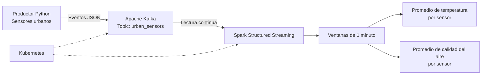

# Plataforma de Muestreo Urbano en Tiempo Real

## 1. Descripción

Este proyecto implementa una plataforma de procesamiento distribuido para simular sensores urbanos. Los eventos se publican en Apache Kafka y se procesan en tiempo real mediante Apache Spark Structured Streaming.

## 2. Arquitectura



## 3. Tecnologías utilizadas

- Python: generación de eventos de sensores.
- Apache Kafka 3.9.1: mensajería distribuida.
- Apache Spark 3.5.5: procesamiento de flujos de datos.
- Kubernetes: despliegue y administración de los servicios.
- Docker: construcción de la imagen de Spark.

## 4. Estructura del proyecto

```text
urban-sensors-streaming/
├── k8s/
│   ├── namespace.yaml
│   ├── configmap.yaml
│   ├── kafka.yaml
│   └── spark.yaml
├── producer/
│   ├── producer.py
│   └── requirements.txt
├── spark/
│   ├── Dockerfile
│   └── streaming_job.py
├── .gitignore
└── README.md
```

## 5. Formato de los eventos

El productor genera eventos JSON con los siguientes campos:

- `sensor_id`: identificador del sensor.
- `temperature`: temperatura medida.
- `humidity`: humedad registrada.
- `air_quality_index`: índice de calidad del aire.
- `timestamp`: fecha y hora del evento en formato ISO 8601.

## 6. Procesamiento con Spark

Spark consume los eventos del topic `urban_sensors`, interpreta los mensajes JSON y agrupa los datos por sensor en ventanas de tiempo de un minuto.

Para cada sensor calcula:

- Promedio de temperatura.
- Promedio del índice de calidad del aire.

El resultado se muestra en la consola de los logs del contenedor Spark.

## 7. Despliegue en Kubernetes

Ejecutar desde la carpeta raíz del proyecto, con Docker Desktop y Kubernetes iniciados:

```powershell
kubectl apply -f .\k8s\namespace.yaml
kubectl apply -f .\k8s\configmap.yaml
kubectl apply -f .\k8s\kafka.yaml
kubectl apply -f .\k8s\spark.yaml
```

Comprobar el estado de los componentes:

```powershell
kubectl get pods -n urban-sensors
kubectl get services -n urban-sensors
```

Verificar que el topic tenga tres particiones:

```powershell
kubectl exec deployment/kafka -n urban-sensors -- /opt/kafka/bin/kafka-topics.sh --bootstrap-server kafka:9092 --describe --topic urban_sensors
```

## 8. Ejecutar el productor Python

En una terminal de PowerShell, desde la carpeta raíz del proyecto:

```powershell
.\.venv\Scripts\python.exe -m pip install -r .\producer\requirements.txt
$env:KAFKA_BOOTSTRAP_SERVERS = "localhost:9094"
python .\producer\producer.py
```

Para que el productor pueda conectarse desde Windows, abrir otra terminal y mantener activo el reenvío del puerto de Kafka:

```powershell
kubectl port-forward service/kafka 9094:9094 -n urban-sensors
```

## 9. Verificar el procesamiento

Consultar los logs de Spark:

```powershell
kubectl logs deployment/spark-streaming -n urban-sensors --follow
```

En la salida se deben observar los resultados de los lotes procesados, con las ventanas temporales, los identificadores de sensores y los promedios calculados.

## 10. Consideraciones

- La plataforma utiliza datos sintéticos generados por el productor Python.
- Kafka está configurado con un broker y tres particiones para el entorno de práctica.
- La configuración de un único broker utiliza factor de replicación 1; no representa una configuración de alta disponibilidad para producción.
- La imagen local `urban-sensors-spark:1.0` debe estar disponible para el nodo de Kubernetes antes de desplegar Spark.
- Los resultados se consultan mediante los logs de Spark; no se configura almacenamiento persistente de resultados en una base de datos.

## 11. Evidencias

Agregar capturas de pantalla que demuestren:

1. Los pods de Kafka y Spark en estado `Running`.
2. El topic `urban_sensors` con tres particiones.
3. El productor publicando eventos JSON.
4. Los logs de Spark mostrando los promedios por sensor.

